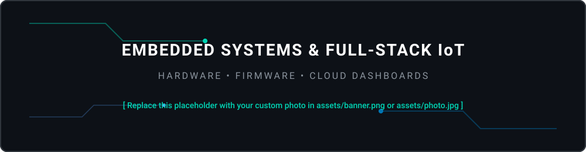

<h1 align="left">RK BHARADWAJ</h1>

<!-- Social & Portfolio Badges (Exact match to your image) -->

  
  
  
  

<!-- ======================================================== -->
<!-- CUSTOM PHOTO SECTION                                     -->
<!-- Put your image in the 'assets' folder (e.g. assets/photo.jpg) -->
<!-- and update the 'src' below to point to your image file.   -->
<!-- ======================================================== -->

  

<!-- 
TIP: If you want to show 2 side-by-side photos (e.g., PCB + hardware setup), you can use this:

  
  

-->

### ⚡ About Me

- 🛠️ **Role:** Embedded Systems & Full-Stack IoT Developer | Hardware & Firmware Engineer
- 🔌 **Hardware & Firmware:** I design custom PCBs and write C/C++ and MicroPython firmware for microcontrollers.
- 🌐 **Cloud & IoT:** I build web dashboards to connect physical devices to the cloud.

---

### 🧰 Skills & Technologies

- **Hardware & EDA:** Custom PCB Design, KiCad, Schematics, Circuit Prototyping
- **Firmware & Microcontrollers:** C, C++, MicroPython, ESP32, STM32, Arduino, ARM Cortex
- **Protocols & Communication:** MQTT, HTTP/REST, WebSockets, UART, I2C, SPI, BLE, Wi-Fi
- **Full-Stack & Cloud:** Node.js, Web Dashboards, Cloud IoT Integration, REST APIs

---

### 📬 Get In Touch

- **Portfolio:** [Visit Portfolio](https://YOUR_PORTFOLIO_URL.com)
- **LinkedIn:** [Connect on LinkedIn](https://www.linkedin.com/in/YOUR_LINKEDIN_USERNAME)
- **GitHub:** [Follow on GitHub](https://github.com/rk-bharadwaj)
